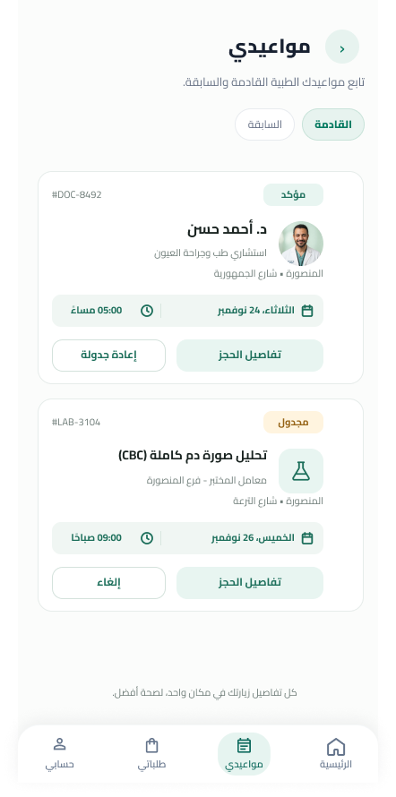
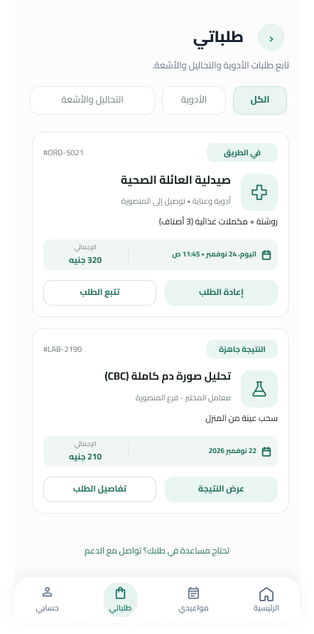
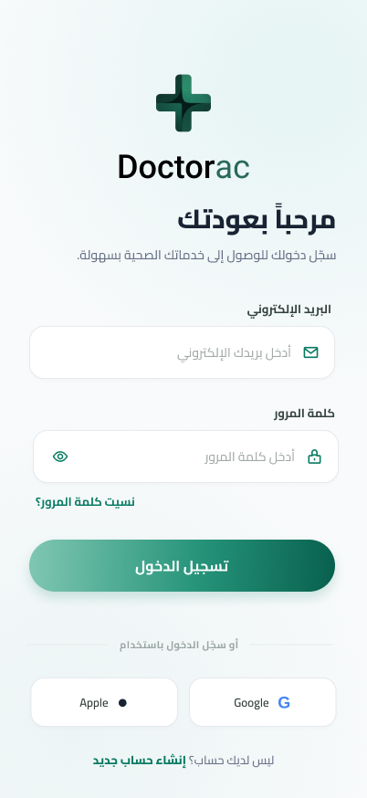
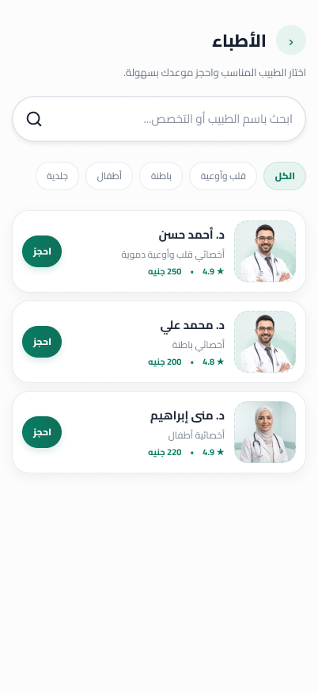
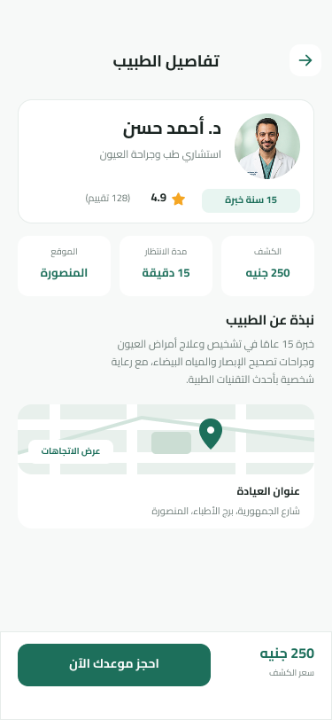
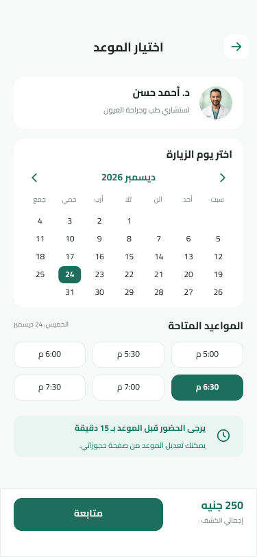
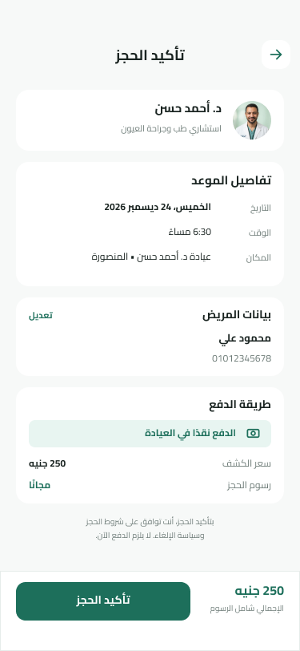
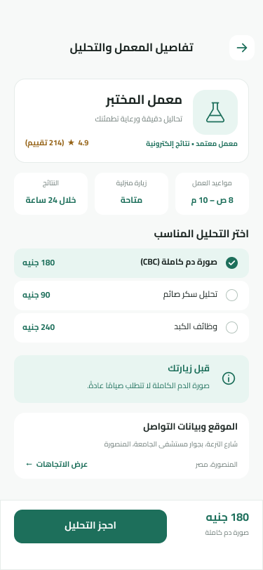
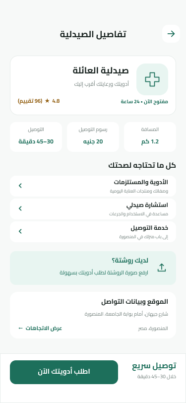

<div align="center">


<br />

# Doctorac | دكتوراك

**تطبيق رعاية صحية متكامل باللغة العربية (RTL) — All-in-One Arabic Healthcare Platform**

[](https://flutter.dev)
[](https://supabase.com)
[](https://riverpod.dev)
[](https://www.openstreetmap.org)
[](https://github.com/zxrelking/doctorac/releases/latest)

[⬇️ Download Android APK (`v1.0.0`)](https://github.com/zxrelking/doctorac/releases/latest) · [📱 Explore Every Tab & Screen](#-app-showcase--every-tab-explained) · [🏗️ Architecture](#%EF%B8%8F-architecture--tech-stack) · [🚀 Setup Guide](#-getting-started)

</div>

---

## ✨ About Doctorac (عن دكتوراك)

**Doctorac (دكتوراك)** is a production-ready **Arabic (RTL)** mobile healthcare super-app built with **Flutter (Dart 3)**, **Feature-First Clean Architecture**, **Riverpod**, **GoRouter**, and **Supabase**.

It brings every medical service a patient needs across **all 27 Egyptian governorates** into one unified experience:
- 🩺 **Book Doctors** by specialty, rating, consultation fee, and real GPS proximity.
- 🧪 **Medical Labs & Tests** with dynamic test pricing and fasting/preparation checklists.
- 💊 **Nearby Pharmacies** with real-time distance sorting and **prescription photo upload** to Supabase Storage.
- 🩻 **Radiology Centers** (MRI, CT, X-Ray, Ultrasound) with automatic lowest-price discovery and safety advisories.
- 🗺️ **Live Nearby GPS Map** (`flutter_map` + OpenStreetMap + OSRM) with a pulsing live blue dot, in-app blue road navigation, Google Maps handoff, and direct in-sheet booking & medicine ordering.
- ❌ **Instant Cancellation & Rescheduling** with one-tap red `X` cancellation dialogs on both **My Bookings** and **My Orders**.

---

## 📱 App Showcase — Every Tab Explained

### 1. Persistent Bottom Navigation Tabs (شريط التنقل السفلي الرئيسي)

The app uses GoRouter's `StatefulShellRoute.indexedStack` to preserve each tab's scroll and state seamlessly across **5 tabs**: **Home (الرئيسية)**, **Live Map (الخريطة)**, **My Bookings (مواعيدي)**, **My Orders (طلباتي)**, and **Profile (حسابي)**.

| Home · الرئيسية | My Bookings · مواعيدي | My Orders · طلباتي | Profile · حسابي |
| :---: | :---: | :---: | :---: |
|  |  |  |  |

- **🏠 Home Tab (`الرئيسية`):** Displays the user's real profile avatar, live GPS location selector (covering all 27 Egyptian governorates), personalized Arabic greeting with ECG wave graphics, a **Global Unified Search bar** (searches doctors, labs, pharmacies, and radiology simultaneously), a 2×2 Services Grid, and top nearby doctors.
- **🗺️ Live Nearby Map Tab (`الخريطة`):** Interactive OpenStreetMap view powered by `flutter_map` + `geolocator` live streaming (`distanceFilter: 5m`). Shows a pulsing blue dot for the user's live GPS location, color-coded pins with place names for **Hospitals, Pharmacies, and Doctors**, quick category filter chips, an in-app **OSRM blue road polyline** with ETA & distance, external **Google Maps** launch, and an interactive bottom sheet for instant appointment booking or medicine ordering.
- **📅 My Bookings Tab (`مواعيدي`):** Splits appointments into **Upcoming (القادمة)** and **Past (السابقة)** with color-coded status badges (`مؤكد`, `مجدول`, `ملغي`), booking reference codes, appointment detail sheets, live **Rescheduling**, and a circular **Red `X` cancel button** with confirmation dialog synced directly to Supabase.
- **🛍️ My Orders Tab (`طلباتي`):** Filterable by **All / Medications / Labs & Radiology**. Supports step-by-step **Order Tracking**, one-tap **Re-order**, an interactive **Lab Results Viewer** comparing patient values against normal ranges, and a **Red `X` cancel button** for active pharmacy orders.
- **👤 Profile Tab (`حسابي`):** Loads and updates real authenticated user data from Supabase (`profiles` + `auth.users` metadata), uploads custom avatars from Camera/Gallery to **Supabase Storage (`avatars`)**, includes a one-tap **GPS auto-fill address** button, and cleanly invalidates cached Riverpod state on sign-out.

---

### 2. Onboarding & Authentication Flow (شاشات البداية وتسجيل الدخول)

| Splash · شاشة البداية | Login · تسجيل الدخول | Sign Up · إنشاء حساب | Reset Password · كلمة المرور |
| :---: | :---: | :---: | :---: |
|  |  |  |  |

- **Splash Screen:** Smooth fade & scale entrance animation with Doctorac's custom `CustomPainter` 3D emerald cross logo, automatically checking the active Supabase session to route users to `/home` or `/login`.
- **Login Screen:** Email & password sign-in with instant Arabic error translation, password recovery modal, and live **Google OAuth** login via Android deep link (`io.doctorac.app://login-callback/`).
- **Sign Up Screen:** Collects real patient details (full name, email, phone, password, and GPS-detected address) and persists them immediately into Supabase Auth and the `profiles` table.
- **Reset Password Screen:** Real-time password strength checklist (minimum 8 characters + letters & numbers) that highlights green as requirements are met and updates credentials via `client.auth.updateUser`.

---

### 3. Doctors Discovery & End-to-End Booking Flow (الأطباء وحجز المواعيد)

| Doctors · الأطباء | Doctor Details · تفاصيل الطبيب | Date & Time · اختيار الموعد | Confirmation · تأكيد الحجز | Success · تم الحجز بنجاح |
| :---: | :---: | :---: | :---: | :---: |
|  |  |  |  |  |

- **Doctors List (`الأطباء`):** Instant search by name, specialty, or governorate + 6 specialty filter chips, sorted automatically by nearest real-world Haversine distance to the user.
- **Doctor Details (`تفاصيل الطبيب`):** Full doctor profile, experience, rating, consultation fee, waiting time, interactive clinic map card with Google Maps directions, and a persistent sticky bottom CTA bar.
- **Select Date & Time (`اختيار الموعد`):** Reusable Arabic `TableCalendar` + 3×2 time-slot grid shared across Doctors, Labs, Radiology, and Rescheduling flows.
- **Booking Confirmation (`تأكيد الحجز`):** Auto-fills patient details from the user's real profile (with an inline edit dialog when booking for a family member), displays zero-fee transparent pricing, and saves the booking to Supabase.
- **Booking Success (`تم الحجز بنجاح`):** Generates a unique booking reference (`DRC-...` / `LAB-...` / `RAD-...`), includes a one-tap **Add to Google Calendar** button, and clears the confirmation stack to prevent duplicate bookings.

---

### 4. Medical Labs, Pharmacies & Radiology (المعامل، الصيدليات والأشعة)

| Labs · المعامل | Lab Details · تفاصيل المعمل | Pharmacies · الصيدليات | Pharmacy Details · تفاصيل الصيدلية | Radiology · الأشعة | Radiology Details · تفاصيل الأشعة |
| :---: | :---: | :---: | :---: | :---: | :---: |
|  |  |  |  |  |  |

- **Medical Labs (`المعامل والتحاليل`):** Flattened searchable catalog across 15 Egyptian labs & 26 tests. Selecting any test in **Lab Details** dynamically updates the sticky bottom price bar and the **"Before Your Visit" (`قبل زيارتك`)** fasting/preparation instructions in real time.
- **Pharmacies (`الصيدليات`):** 20 nationwide pharmacies sorted live by GPS distance with **"Open Now"** and **"Home Delivery"** filters. Inside **Pharmacy Details**, patients can snap or pick a **prescription image** (uploaded directly to Supabase Storage bucket `prescriptions`) or type medications to create a live order in `My Orders`.
- **Radiology (`الأشعة`):** Features a custom 3D MRI hero card and automatically computes the lowest starting price for **MRI, CT, X-Ray, and Ultrasound** across 12 radiology centers. **Radiology Details** dynamically updates pricing and scan-specific safety advisories (e.g., metal implant warnings for MRI).

---

## 🏗️ Architecture & Tech Stack

| Layer | Technology |
| :--- | :--- |
| **Framework** | Flutter (Dart 3, Null Safety, Material 3, RTL `ar_EG`) |
| **Architecture** | Feature-First Clean Architecture (`domain` / `data` / `presentation`) |
| **State Management** | `flutter_riverpod` (`FutureProvider`, `AsyncNotifierProvider`, `StateNotifierProvider`) |
| **Navigation** | `go_router` with 5-tab `StatefulShellRoute.indexedStack` |
| **Backend & Database** | **Supabase** — PostgreSQL (9 tables + RLS + Triggers), Auth (Email + Google OAuth), Storage |
| **Maps & Live GPS** | `flutter_map` + OpenStreetMap + `geolocator` + `geocoding` + **OSRM Routing API** |
| **Design System** | Medical Teal `#1A6B54`, Soft Mint `#EBF5F1`, Off-White `#F8FAF9`, `Cairo` via `google_fonts` |

```text
doctorac/
├── assets/
│   ├── icon/app_icon.png              # Custom 3D emerald cross launcher icon
│   └── images/mri_banner.jpg          # 3D MRI hero visual for Radiology section
├── docs/
│   ├── banner.jpg                     # GitHub README hero banner
│   └── screenshots/                   # 19 screen showcase images (01..19)
├── supabase_schema.sql                # 9 PostgreSQL tables, RLS policies, Storage buckets & Triggers
├── supabase_seed.sql                  # Nationwide Egyptian healthcare dataset (27 governorates)
└── lib/
    ├── main.dart                      # App bootstrap, portrait lock, Arabic locale & Supabase init
    ├── app.dart                       # Enforced RTL Directionality, Cairo theme & GoRouter
    ├── core/
    │   ├── config/supabase_config.dart
    │   ├── location/                  # 27 Egypt governorates, Haversine distance, real GPS provider
    │   ├── router/app_router.dart     # Full route graph + 5-tab StatefulShellRoute
    │   ├── theme/                     # AppColors & AppTheme
    │   ├── utils/                     # ArabicDateFormatter & external Maps/Calendar launcher
    │   └── widgets/                   # 3D CustomPainter logo, MainShellScaffold, StickyBottomBar...
    └── features/
        ├── auth/                      # Splash, Login, SignUp, Reset Password
        ├── home/                      # Home, Global Unified Search & Egypt Location Picker
        ├── map/                       # Live Nearby Map, OSRM Blue Route & Booking/Order Bottom Sheet
        ├── doctors/                   # Doctors List & Doctor Details
        ├── bookings/                  # Select Date/Time, Confirmation, Success & My Bookings
        ├── labs/                      # Labs List & Dynamic Lab Details
        ├── pharmacies/                # GPS-Sorted Pharmacies & Prescription Upload
        ├── radiology/                 # Radiology List (MRI Banner) & Radiology Details
        ├── orders/                    # My Orders, Tracking Stepper & Lab Results Viewer
        └── profile/                   # Real Editable Profile & Avatar Storage Upload
```

---

## 🗄️ Supabase Database Overview

The PostgreSQL schema in [`supabase_schema.sql`](supabase_schema.sql) defines **9 relational tables** secured with **Row Level Security (RLS)**:
- **Public Medical Catalog:** `doctors`, `labs`, `lab_tests`, `pharmacies`, `radiology_centers`, `radiology_scans`.
- **Private User Tables (`auth.uid() = user_id`):** `profiles`, `bookings`, `orders`.
- **Automation:** `handle_new_user()` trigger automatically creates a real user profile row on registration, and Supabase Storage hosts `avatars`, `prescriptions`, and `lab_results`.

---

## 🚀 Getting Started

### 1. Clone & Install Dependencies
```bash
git clone https://github.com/zxrelking/doctorac.git
cd doctorac
flutter pub get
```

### 2. Configure Supabase
1. Create a free project on [Supabase](https://supabase.com/).
2. Run [`supabase_schema.sql`](supabase_schema.sql) followed by [`supabase_seed.sql`](supabase_seed.sql) in the **SQL Editor**.
3. Enable **Google** under **Authentication → Providers** and add `io.doctorac.app://login-callback/` to **URL Configuration → Redirect URLs**.

### 3. Run or Build APK
```bash
# Run on a connected Android device/emulator
flutter run \
  --dart-define=SUPABASE_URL=https://YOUR_PROJECT.supabase.co \
  --dart-define=SUPABASE_ANON_KEY=YOUR_ANON_KEY

# Build release APK
flutter build apk --release
```

---

<div align="center">
  <sub>Built with ❤️ using Flutter & Supabase — <strong>Doctorac (دكتوراك)</strong></sub>
</div>
